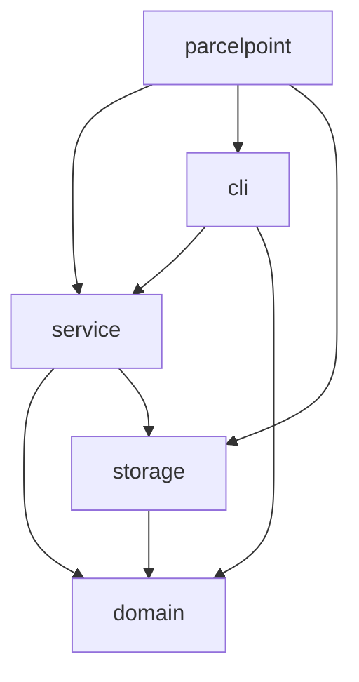
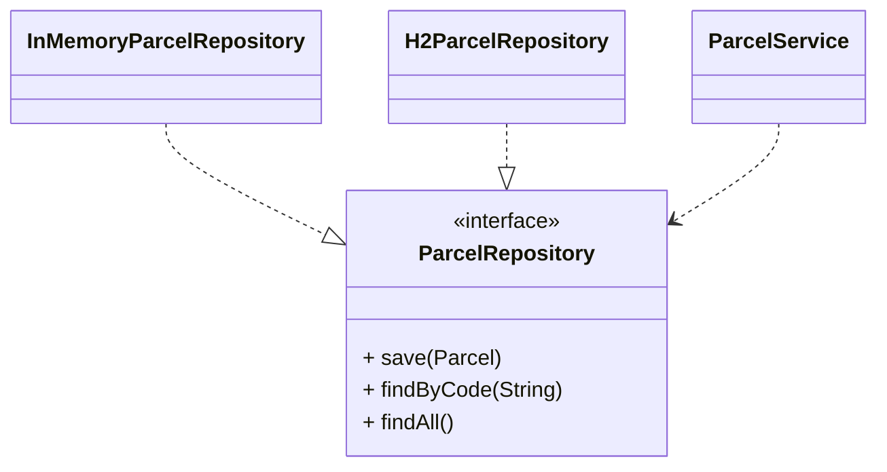
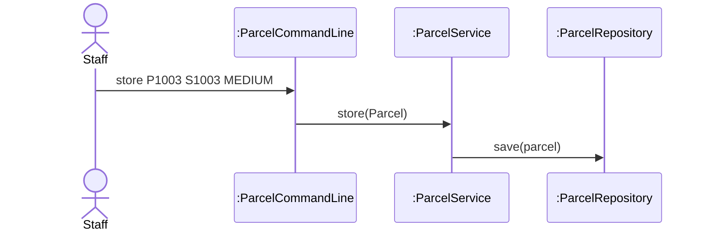

# Lab Report, Designing the Data Management Layer with H2

Repository URL:

## Tools

| Item | Version or name |
| --- | --- |
| JDK | 27.0.1 |
| Maven | 3.10.0 |
| IDE | 1.144.0 |
| AI tool and exact model, if you used one | ChatGPT (GPT-6) |

## Part 0. From a store in memory to H2

Commit of the starter, before any change: 520b629

0.3 Your prediction for `staff`, written before the second run:

Output of the second run, for `staff` and `quit`:

```text
> staff
Free lockers: 3
> quit
```

State in one sentence where you think the parcels of the first run were kept.
<br>ANS: The parcels were kept in the computer's memory.

0.5 The line of Main that you would change to keep the parcels somewhere else:

```java
ParcelRepository repository = new H2ParcelRepository("./data/parcelpoint");
```

0.6 Commit of the switch to H2: 0d5a7e9

0.7 Output of `SELECT * FROM PARCEL;` after you stored two parcels:

```text
CODE  | STUDENT_ID | PARCEL_SIZE | STATUS | LOCKER_NUMBER
P1001 | S1001      | SMALL       | STORED | 1
P1002 | S1002      | LARGE       | STORED | 3
(2 rows, 1 ms)
```

0.8 Explain why ParcelPoint could not start while the H2 Shell was open, and identify the class that wrote the message `Cannot create the PARCEL table`.
<br>ANS : The H2 Shell had already opened and locked the database making ParcelPoint cannot access the same database. And for the class that worte the message is H2ParcelRepository. <br>

0.9 Explain why `staff` shows no parcel while `find` shows each one, and why all three lockers look free.
<br> ANS: `find` implements findByCode(), which can retrieve data directly from H2 database. While, `staff` uses findAll(), which has not been implemented yet. All tree lockers look free because the parcel data has not been loaded from the database.

0.11 Your findAll method:

```java
@Override
public List<Parcel> findAll() {
    List<Parcel> parcels = new ArrayList<>();
    String sql = "SELECT * FROM PARCEL ORDER BY CODE";

    try (Connection connection = connect();
         PreparedStatement statement = connection.prepareStatement(sql);
         ResultSet rows = statement.executeQuery()) {

        while (rows.next()) {
            parcels.add(toParcel(rows));
        }

    } catch (SQLException e) {
        throw new IllegalStateException("Cannot read the parcels", e);
    }

    return parcels;
}
```

Commit that adds findAll: e704de1

0.12 Output of `SELECT * FROM PARCEL;` after the pickup:

```text
CODE  | STUDENT_ID | PARCEL_SIZE | STATUS    | LOCKER_NUMBER
P1001 | S1001      | SMALL       | PICKED_UP | null
P1002 | S1002      | LARGE       | STORED    | 3
(2 rows, 35 ms)
```

0.13 Optional. Describe what `find P9999'OR'1'='1` showed while the SQL was joined from strings, and what it showed after you put the placeholder back.

## Part A. Model the design

A1 Complete the flowchart with one node for each package and one arrow for each dependency, from the package that uses to the package that is used. Mark the package that accesses the data store.



State whether cli depends on storage, and explain why.
<br> ANS : No, since cli uses service to handle business logic and service uses storage to access database.

A2 Complete the class diagram of the data management layer with ParcelService, the interface ParcelRepository with its three operations, and the two classes that implement it.



A3 Draw a sequence diagram for the command `store P1003 S1003 MEDIUM`, from the staff member to the repository. Show each message as an operation of the class that receives it.



Explain why the last lifeline is the interface ParcelRepository rather than H2ParcelRepository.
<br> ANS : It allows the repository implementation to be changed without modifying ParcelService.
## Part B. Design questions

1. Identify the files that you changed to move from the store in memory to H2, and explain why no other class had to change. Use the terms of this course.
<br> ANS : 'Main.java' is changed from InMemoryParcelRepository to H2ParcelRepository, since 'ParcelService' depends on 'ParcelRepository' interface. This allow polymorphism, so it's not necessary to modify 'ParcelService'.

2. The PARCEL table stores the size of a parcel as SMALL, MEDIUM or LARGE rather than as 1, 2 or 3. Identify the type of connascence between ParcelSize and the table in each case, and explain which one is weaker.
<br> ANS : Storing the size of a parcel as SMALL, MEDIUM or LARGE creates connascence of name(CoN), while storing as 1, 2 or 3 creates connascence of meaning(CoM). CoN is weaker beacause it doesn't need to remember the meaning like 1, 2, or 3.

3. Project Phase 2 asks for a data store that needs no separate server. Explain why an embedded database such as H2 meets this rule, and describe the limit of an embedded database that Step 0.8 showed.
<br> ANS : An embedded database stores data in local file. It is locked, while there're another process trying to access at the same time.

4. State the data store that you would choose for your Project Phase 2 team, files or an embedded database, the requirement that drives the choice, and the package that will access it.
<br> ANS : An embedded database. In project phase 2, it contain related data that can be managed and queried using SQL.
## AI usage declaration

| AI tool and exact model | Date | Purpose | Files or answers it produced or changed | How you checked its output |
| --- | --- | --- | --- | --- |
| ChatGPT (GPT-6) | 9/11/2026 | Lab explanations and answer checking | --- | Checked with source code and test results |
| ChatGPT (GPT-6) | 9/11/2026 |Helped with findAll() implementation | H2ParcelRepository.java | Tested the code and checked the output |

